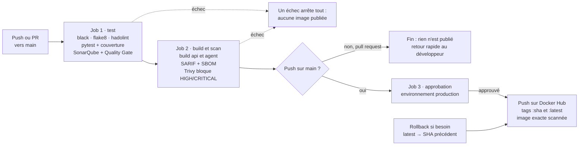

# TP DevOps INGC2 — Chaîne DevSecOps du System Metrics Agent

**Contributeurs :** [@APEDOH Kossi Kékéli](https://github.com/marcapedoh) · @MAHANGA Mboumba Celly — 13 octobre 2026


Images publiées : [`marcapedoh04/system-metrics-api`](https://hub.docker.com/r/marcapedoh04/system-metrics-api) · [`marcapedoh04/system-metrics-agent`](https://hub.docker.com/r/marcapedoh04/system-metrics-agent)



## Sommaire

1. [Le projet forké](#1-le-projet-forké--system_metrics_agent)
2. [Le travail demandé et pourquoi](#2-le-travail-demandé-et-pourquoi)
3. [État initial du dépôt et pièges corrigés](#3-état-initial-du-dépôt-et-pièges-corrigés)
4. [Les fichiers ajoutés](#4-les-fichiers-ajoutés)
5. [SonarQube : rôle et lecture des métriques](#5-sonarqube--rôle-et-lecture-des-métriques)
6. [pytest, coverage.xml et relative_files](#6-pytest-coveragexml-et-relative_files)
7. [Erreurs rencontrées pendant les tests](#7-erreurs-rencontrées-pendant-les-tests)
8. [black : le formateur de code](#8-black--le-formateur-de-code)
9. [flake8 : le linter](#9-flake8--le-linter)
10. [Le pipeline ci-cd.yml et ses actions](#10-le-pipeline-ci-cdyml-et-ses-actions)
11. [Validation humaine du déploiement](#11-la-touche-finale--validation-humaine-du-déploiement)
12. [Autres incidents et conclusion](#12-autres-incidents-et-conclusion)

## Démarrage rapide

```bash
cp .env.example .env
docker compose up --build -d
curl http://localhost:8000/metrics/latest
```

Tests en local : `pip install -r requirements-dev.txt`, puis `python -m pytest --cov=app`.
SonarQube local : `docker compose -f docker-compose.sonar.yml up -d`, puis http://localhost:9000.

---

## 1. Le projet forké : system_metrics_agent

Le projet [system_metrics_agent](https://github.com/Mficius/system_metrics_agent) est un petit système de supervision écrit en Python : un **agent** mesure l'état d'une machine et l'envoie à une **API** qui le stocke. Il reproduit en miniature des outils comme Prometheus node_exporter ou l'agent Datadog.

Il est composé de deux programmes indépendants qui communiquent en HTTP :

- **L'agent** (`app/agent.py`) collecte toutes les N secondes le pourcentage CPU, la mémoire RAM et la charge système, puis envoie le résultat à l'API.
- **L'API** (`app/api.py`, FastAPI) reçoit les métriques sur `POST /metrics`, expose `GET /health` pour indiquer qu'elle est vivante et `GET /metrics/latest` pour lire la dernière mesure. Les données sont gardées en mémoire, dans une simple liste Python.

Le code de l'agent est découpé en modules qui ont chacun une seule responsabilité :

| Fichier | Rôle |
| --- | --- |
| `app/collector.py` | Collecte CPU et RAM avec la bibliothèque `psutil`, et la charge système en exécutant la commande Linux `uptime` via `subprocess` |
| `app/formatter.py` | Met les mesures dans un format JSON standard (`agent`, `event_type`, `data`) et vérifie qu'aucune clé ne manque |
| `app/sender.py` | Envoie le JSON à l'API avec `requests` et transforme les erreurs réseau en une erreur claire `MetricsDeliveryError` |
| `app/agent.py` | Orchestre le cycle collecte → formatage → envoi, en boucle |
| `app/config.py` | Lit la configuration dans les variables d'environnement : `METRICS_ENDPOINT`, `COLLECTION_INTERVAL`, `REQUEST_TIMEOUT` |
| `app/api.py` | L'API FastAPI de réception |

Le parcours d'une mesure : la machine → `collector.py` → `formatter.py` → `sender.py` → `POST /metrics` sur l'API → lisible sur `GET /metrics/latest`.

## 2. Le travail demandé et pourquoi

Le TP demande de faire passer ce projet dans une **chaîne DevSecOps complète** : chaque modification du code doit être testée, analysée, empaquetée dans une image Docker, scannée pour les failles, puis publiée automatiquement. L'objectif n'est pas de modifier le code de l'application, mais l'usine qui la livre.

| Partie | Ce qui est demandé | Pourquoi |
| --- | --- | --- |
| 1. Fork et prise en main (2 pts) | Forker, lancer le projet, faire passer `pytest`, travailler sur une branche `feature/devops` | On ne construit pas de pipeline sur un projet qu'on ne sait pas faire tourner. La branche isole le travail de `main`. |
| 2. Dockeriser (5 pts) | Un Dockerfile pour l'API, un pour l'agent, optimisés pour la production | Une image contient le programme et tout son environnement : elle tourne à l'identique sur tous les postes et serveurs. |
| 3. Docker Compose (3 pts) | Lancer API + agent en une commande | Reproduire en local l'architecture réelle à deux services, avec réseau et dépendances. |
| 4. Pipeline GitHub Actions (8 pts) | Tests + SonarQube + Quality Gate, puis build + Trivy + push Docker Hub | Automatiser les contrôles : aucun humain n'oublie une étape, et rien de non conforme n'arrive en production. |

Les exigences de la Partie 2 répondent chacune à un risque précis :

- **Image de base légère et tag précis, jamais `latest`** : une image plus petite se télécharge plus vite et contient moins de logiciels donc moins de failles. Un tag précis garantit que le build de demain sera identique à celui d'aujourd'hui.
- **Build multi-stage** : les outils d'installation restent dans une étape intermédiaire et ne partent pas en production.
- **`requirements.txt` copié avant le code** : Docker réutilise la couche des dépendances tant qu'elles ne changent pas, et les builds passent de plusieurs minutes à quelques secondes.
- **Utilisateur non-root, aucun secret dans l'image** : si l'application est piratée, l'attaquant n'a pas les droits d'administrateur dans le conteneur et ne trouve aucun mot de passe.
- **`HEALTHCHECK`, uvicorn sans `--reload`** : Docker sait si l'API répond vraiment, et le mode rechargement à chaud, réservé au développement, est désactivé.
- **Configuration par variables d'environnement** : la même image sert en test et en production ; seule la configuration change.

La Partie 4 impose deux jobs enchaînés : si les tests ou la porte qualité échouent, l'image n'est même pas construite. Le push n'a lieu que sur `main`, jamais depuis une pull request.

## 3. État initial du dépôt et pièges corrigés

Le dépôt contenait plusieurs pièges volontaires, que la Partie 1 demandait de repérer (« vérifiez la réalité du dépôt »). Les voici, avec la correction appliquée.

| Constat | Conséquence | Correction |
| --- | --- | --- |
| Tests dans `app/tests/`, alors que le README annonçait `tests/` | Documentation fausse ; tests mélangés au code de production | Tests déplacés dans `tests/` à la racine |
| `test_api.py` annoncé mais absent | L'API n'était pas testée du tout | Tests ajoutés : API, configuration et agent (27 tests au total) |
| `app/montFichier.py` : import `calendar` inutilisé, fonction jamais appelée | Code mort signalé par flake8 (F401) et SonarQube, et 0 % de couverture | Fichier supprimé |
| `black --check` échouait sur 7 fichiers | Le pipeline d'origine était rouge d'office | Code reformaté avec black |
| `requirements.txt` mélangeait pytest, black, flake8 et les dépendances de l'application | Les outils de développement seraient partis dans l'image de production | Séparé en `requirements.txt` et `requirements-dev.txt` |
| Ancien workflow : déploiement SSH vers un chemin Windows (`C:/Users/GCS/...`) | Pipeline inutilisable, non conforme au TP | Remplacé par `ci-cd.yml` |

**Ce qui a changé dans `app/`.** Le code métier de l'application n'a pas été réécrit : le pipeline a été construit autour de lui. Les seules modifications sont :

- le **reformatage black** des fichiers existants (espaces, retours à la ligne), sans effet sur le comportement ;
- la **suppression** de `montFichier.py` ;
- un ajout dans `agent.py` : l'**arrêt propre sur SIGTERM**. Sans lui, `docker stop` attendait 10 secondes avant de tuer l'agent de force ; avec lui, l'agent s'arrête en moins d'une seconde.

## 4. Les fichiers ajoutés

Chaque fichier ajouté a un rôle unique dans la chaîne. Le tableau donne la vue d'ensemble ; les points qui suivent détaillent les choix importants.

| Fichier | Rôle | Quand il sert |
| --- | --- | --- |
| `Dockerfile.api` | Recette de l'image de l'API | `docker compose build`, job de build du pipeline |
| `Dockerfile.agent` | Recette de l'image de l'agent | Idem |
| `.dockerignore` | Liste de ce qui n'entre pas dans l'image | À chaque build Docker |
| `.gitignore` | Liste de ce qui n'entre pas dans Git | À chaque `git add` |
| `.env.example` | Modèle de configuration, versionné | Copié en `.env` avant le premier lancement |
| `.env` | Configuration locale réelle, jamais versionnée | Lu par Docker Compose et par l'agent hors Docker |
| `docker-compose.yml` | Lance l'API et l'agent ensemble | `docker compose up --build` |
| `docker-compose.sonar.yml` | Lance SonarQube et sa base PostgreSQL en local | Analyse de qualité sur le poste |
| `sonar-project.properties` | Configuration de l'analyse SonarQube | À chaque analyse, locale ou en CI |
| `pyproject.toml` | Configuration de pytest, coverage et black | À chaque exécution de ces outils |
| `.flake8` | Configuration de flake8 | À chaque lint |
| `requirements.txt` | Dépendances d'exécution | Installées dans les images |
| `requirements-dev.txt` | Dépendances de test et de lint | Installées sur le poste et en CI |
| `tests/` | Tests unitaires | `pytest`, en local et en CI |
| `.github/workflows/ci-cd.yml` | Pipeline principal | À chaque push et pull request vers `main` |
| `.github/workflows/release.yml` | Rollback et suppression manuels | Bouton « Run workflow » |
| `.github/dependabot.yml` | Mises à jour automatiques des dépendances | Chaque semaine |

### Il n'y a pas de fichier « .black8 »

Le nom mélange deux outils. **black** est configuré dans `pyproject.toml`, section `[tool.black]`. **flake8** ne sait pas lire `pyproject.toml`, il a donc son propre fichier `.flake8`. Les deux sont détaillés aux sections 8 et 9.

### Dockerfiles et .dockerignore

Chaque image est construite en deux étapes. L'étape `builder` crée un environnement virtuel et y installe les dépendances. L'étape finale part d'une image propre, copie seulement cet environnement et le code, retire `pip`, crée l'utilisateur `app` (UID 10001) et lance le programme sous cet utilisateur. L'image de l'agent ajoute le paquet Debian `procps`, qui fournit la commande `uptime` absente de l'image `slim`.

Le `.dockerignore` exclut `.git`, `.venv`, `.env`, les tests et les caches. Sans lui, un `COPY` pourrait embarquer le fichier `.env` et ses secrets dans une image publique sur Docker Hub.

**Pourquoi pas une seule image ?** L'API n'a pas besoin de `procps`, et l'agent n'expose pas de port : deux images, c'est deux surfaces d'attaque minimales. **Pourquoi pas Alpine ?** Alpine utilise la bibliothèque C musl ; `psutil` doit alors être compilé, ce qui demande un compilateur et annule le gain de taille.

### .env et .env.example

`.env.example` est versionné et documente chaque variable. `.env` est la copie locale réelle, ignorée par Git et Docker. **Pourquoi ce découpage ?** Un nouveau développeur sait quoi configurer, et aucune valeur sensible n'arrive jamais sur GitHub.

### docker-compose.yml

Il déclare deux services sur un réseau privé `system-metrics-net`. L'agent joint l'API par son nom de service, `http://api:8000/metrics` : dans un conteneur, `127.0.0.1` désigne le conteneur lui-même. `depends_on` avec `condition: service_healthy` fait attendre l'agent jusqu'à ce que le `HEALTHCHECK` de l'API réussisse. En plus des exigences du TP, chaque conteneur est durci : système de fichiers en lecture seule, aucune capability Linux, interdiction d'élévation de privilèges, limites CPU et mémoire.

### docker-compose.sonar.yml

C'est un bonus du TP : un SonarQube complet sur le poste, avec sa base PostgreSQL, ses volumes de données et un healthcheck. Un service optionnel `tunnel` (profil `tunnel`) ouvre un tunnel Cloudflare temporaire pour que les runners GitHub, qui sont dans le cloud, puissent joindre ce SonarQube local. **Pourquoi un fichier séparé ?** SonarQube consomme plusieurs gigaoctets de RAM et n'est pas une dépendance de l'application : on ne le démarre que lorsqu'on veut analyser.

### sonar-project.properties

Il dit à SonarQube quoi analyser : la clé du projet (`system-metrics-agent`), le code source (`sonar.sources=app`), les tests (`sonar.tests=tests`), la version de Python et l'emplacement du rapport de couverture (`coverage.xml`). L'option `sonar.qualitygate.wait=true` fait attendre le verdict de la porte qualité et échouer l'analyse si elle est rouge. **Pourquoi un fichier ?** La même configuration sert en local et en CI, sans paramètres à recopier dans chaque commande.

### dependabot.yml

Dependabot ouvre chaque semaine des pull requests de mise à jour pour trois écosystèmes : les paquets pip, les images de base des Dockerfiles et les actions GitHub. Chaque PR passe dans le pipeline complet, Trivy compris. **Pourquoi ?** Une faille publiée dans une dépendance est corrigée sans attendre qu'un humain y pense.

## 5. SonarQube : rôle et lecture des métriques

SonarQube est un outil d'**analyse statique** : il lit le code sans l'exécuter et y cherche des bugs, des failles de sécurité, du code difficile à maintenir et du code dupliqué. Il rassemble ces résultats avec la couverture de tests et rend un verdict unique, la **Quality Gate** (porte qualité) : *Passed* ou *Failed*.

SonarQube n'exécute aucun test. C'est pytest qui exécute les tests et produit `coverage.xml` ; SonarQube se contente de lire ce rapport.

### Installation locale

1. `docker compose -f docker-compose.sonar.yml up -d`, puis ouverture de `http://localhost:9000`.
2. Premier login `admin` / `admin`, puis changement immédiat du mot de passe.
3. Création manuelle du projet avec la clé `system-metrics-agent`, identique à `sonar.projectKey`.
4. Génération d'un **Project Analysis Token**. Ce type de jeton ne peut qu'analyser ce projet. Un *Global Analysis Token* pourrait analyser tous les projets, un *User Token* aurait tous les droits de l'administrateur : le plus restreint suffit, c'est le principe du moindre privilège.
5. Analyse depuis le poste avec le conteneur `sonarsource/sonar-scanner-cli`, branché sur le réseau `sonar-net`.

### Lire le tableau de bord

| Indicateur | Ce qu'il mesure | Notre résultat |
| --- | --- | --- |
| Quality Gate | Verdict global, calculé sur des conditions précises | Passed |
| Security | Vulnérabilités : faille exploitable (injection, secret en clair…) | 0, note A |
| Reliability | Bugs : code qui produira un mauvais résultat ou plantera | 0, note A |
| Maintainability | Code smells : code qui marche mais coûtera cher à faire évoluer | 0, note A |
| Accepted issues | Problèmes reconnus volontairement comme acceptés par l'équipe | 0 |
| Coverage | Part des lignes et des conditions du code exécutées par les tests | 77,2 % puis ~99 % après correction (section 7) |
| Duplications | Part des lignes copiées-collées | 0,0 % |
| Security Hotspots | Code sensible à vérifier par un humain (ce n'est pas forcément une faille) | 0 |
| Lines of Code | Taille du code de production | 249 |

Les notes vont de **A** (meilleur) à **E**. Une seule vulnérabilité critique fait tomber la note Security à E.

### New Code et Overall Code

**Overall Code** juge tout le projet. **New Code** ne juge que le code ajouté depuis une référence, ici la première analyse. La Quality Gate par défaut, « Sonar way », s'applique au nouveau code : couverture d'au moins 80 %, duplication d'au plus 3 %, aucun nouveau problème. C'est le principe **« Clean as You Code »** : on n'exige pas de réparer tout l'historique d'un projet, mais on interdit toute régression sur ce qu'on ajoute.

Cela explique le message vu au début, « *There are not enough lines to compute coverage* » : entre les deux premières analyses, nous n'avions ajouté que des fichiers de test, et SonarQube ne mesure pas la couverture des tests eux-mêmes.

### Pourquoi le commit Git compte

SonarQube analyse les fichiers du disque, avec ou sans Git. Mais il utilise `git blame` pour dater chaque ligne, savoir ce qui est « nouveau » et attribuer chaque problème à son auteur. Tant que les tests n'étaient pas committés, le log affichait « *Missing blame information* ». C'est aussi pour cela que le pipeline fait le checkout avec `fetch-depth: 0` : l'historique complet est nécessaire au blame.

## 6. pytest, coverage.xml et relative_files

**pytest** est le framework de test de Python : il trouve les fichiers `test_*.py`, exécute chaque fonction `test_*` et signale celles qui échouent. Il était déjà utilisé par le projet d'origine. Nous l'avons gardé et lui avons ajouté **pytest-cov**, un plugin qui mesure quelles lignes du code ont été exécutées pendant les tests. Les deux sont dans `requirements-dev.txt` : ils servent sur le poste et en CI, jamais dans les images.

### Comment coverage.xml est généré

Aucun fichier du projet ne contient de code qui écrit `coverage.xml`. Il est produit par la commande :

```bash
python -m pytest --cov=app --cov-report=xml
```

1. `--cov=app` active pytest-cov sur le dossier `app/`. Le plugin s'appuie sur la bibliothèque **coverage.py**, qui observe chaque ligne exécutée pendant les tests.
2. coverage.py lit sa configuration dans `pyproject.toml`, section `[tool.coverage.run]` : mesurer `app`, mesurer aussi les branches (`branch = true`), écrire des chemins relatifs (`relative_files = true`).
3. `--cov-report=xml` écrit le résultat au format **Cobertura**, un format XML standard : pour chaque fichier, chaque ligne est marquée exécutée ou non.
4. SonarQube lit ce fichier grâce à la ligne `sonar.python.coverage.reportPaths=coverage.xml` de `sonar-project.properties`.

Le fichier est régénéré à chaque exécution. Il est listé dans `.gitignore` car c'est un résultat, pas une source. Dans le pipeline, pytest et l'analyse SonarQube sont dans le même job : le rapport ne peut jamais être périmé.

### À quoi sert relative_files = true

Sans cette option, coverage.py écrit des chemins absolus. Sur notre poste Windows, le rapport contenait `C:\Users\adral\Downloads\TP Devops\system_metrics_agent\app`. Or le scanner SonarQube tourne dans un conteneur Linux où le projet est monté dans `/usr/src` : ce chemin Windows n'y existe pas, et SonarQube affichait 0 % de couverture.

Avec `relative_files = true`, les chemins deviennent `app/agent.py`, `app/api.py`… Ils sont valables partout : sous Windows, dans le conteneur et sur les runners Linux de GitHub.

## 7. Erreurs rencontrées pendant les tests

Quatre problèmes se sont succédé avant d'obtenir 27 tests verts et une couverture correcte. Le dernier, propre à Windows, est le plus instructif.

| Symptôme | Cause | Correction |
| --- | --- | --- |
| `pytest` : « *not recognized* » dans PowerShell | Environnement virtuel non créé ou non activé | `python -m venv .venv`, `.venv\Scripts\Activate.ps1`, `pip install -r requirements-dev.txt` |
| `collected 0 items` | Fichiers nommés `test-api.py` avec un tiret : pytest ne collecte que `test_*.py`, et un nom à tiret ne peut pas être importé en Python | Renommage en `test_api.py`, etc. |
| Couverture SonarQube à 0,0 % | `coverage.xml` datait de l'exécution à 0 test : fichier valide mais vide | Suppression de `coverage.xml` et `.coverage`, puis nouvelle exécution de pytest |
| Couverture à 77,2 % et 4 tests en échec sous Windows | Le collecteur ignore `uptime` sous Windows (détail ci-dessous) | Fixture pytest qui simule Linux |

### Le cas Windows du collecteur

La fonction `get_load_average()` de `app/collector.py` commence par ce test :

```python
if platform.system().lower().startswith("win"):
    return {"load_1m": None, "load_5m": None, "load_15m": None}
```

La commande `uptime` n'existe pas sous Windows. Le code renvoie donc directement des `None`, sans jamais appeler `subprocess.run`. C'est un comportement correct pour l'application.

Le problème venait des tests. Ils remplaçaient `subprocess.run` par un faux (un *mock*) qui renvoyait une sortie `uptime` simulée, puis vérifiaient le parsing. Mais sur notre poste Windows, la fonction sortait avant d'utiliser ce mock. Résultat dans pytest :

```
AssertionError: assert {'load_1m': None, 'load_5m': None, 'load_15m': None}
       == {'load_1m': 0.1, 'load_5m': 0.2, 'load_15m': 0.3}
Failed: DID NOT RAISE <class 'app.collector.MetricsCollectionError'>
```

Toute la partie parsing n'était jamais exécutée, d'où la chute de couverture. En CI, sur Ubuntu, ces tests passaient : le problème était invisible tant qu'on ne testait que sur Linux.

**Comment on l'a trouvé.** Aucun log ne dit « ça échoue à cause de l'OS » : on le déduit en croisant trois sources. pytest dit *quoi* (la fonction renvoie des `None`). Le code dit *pourquoi* (le test sur `platform.system()`). La vue Code de SonarQube montre *où* : en vert la ligne du `if`, en rouge tout le bloc qui suit.

**La correction.** Une fixture `autouse` dans `tests/test_collector.py` fait croire à chaque test du fichier qu'il tourne sous Linux :

```python
@pytest.fixture(autouse=True)
def unix_platform(monkeypatch):
    monkeypatch.setattr("app.collector.platform.system", lambda: "Linux")
```

Le test dédié au cas Windows garde son propre `@patch`, qui prend le dessus. Les tests sont désormais indépendants de la machine qui les exécute, et la couverture remonte à environ 99 %.

Un autre échec est apparu en CI : `run_forever() takes 0 positional arguments` et `module 'app.agent' has no attribute 'stop_event'`. Le fichier `app/agent.py` du dépôt était encore la version d'origine, sans l'arrêt propre que les tests vérifiaient. Le remplacer par la bonne version a suffi.

## 8. black : le formateur de code

**black** réécrit automatiquement le code Python dans un style unique et non négociable. Il ne change jamais ce que fait le programme, seulement sa présentation : espaces, retours à la ligne, guillemets. Son slogan résume l'intérêt : *« Any color you like, as long as it's black »*.

### Quand et pourquoi il a été installé

black était déjà dans le dépôt d'origine, dans `requirements.txt`, et l'ancien pipeline l'utilisait. Nous l'avons déplacé dans `requirements-dev.txt`, car c'est un outil de développement qui n'a rien à faire dans l'image de production. Il s'installe sur le poste avec `pip install -r requirements-dev.txt`, et en CI à l'étape « Installer les dépendances » du job 1.

**Pourquoi en avoir besoin ?** Sans formateur, chaque développeur a ses habitudes, et les relectures de code se perdent en débats de style. Pire : un simple reformatage par un éditeur fait apparaître des centaines de lignes modifiées dans Git, qui cachent les vrais changements. Avec black, le style n'est plus un sujet : le code de toute l'équipe a la même forme.

### Les règles de black

Les règles de black sont presque toutes fixées par l'outil lui-même. Nous n'avons défini que deux réglages, dès la mise en place du pipeline, dans `pyproject.toml` :

```toml
[tool.black]
line-length = 88
target-version = ["py312"]
```

- `line-length = 88` : longueur maximale d'une ligne, la valeur par défaut de black, explicitée pour que flake8 puisse s'y aligner.
- `target-version = ["py312"]` : la syntaxe produite reste compatible avec Python 3.12, la version des images et de la CI.

Les règles appliquées automatiquement, observées dans nos diffs :

- une **ligne vide après la docstring** d'un module ;
- **guillemets doubles** partout ;
- un appel qui tient sur 88 caractères est **regroupé sur une ligne** ; sinon il est éclaté, un argument par ligne, avec une **virgule finale** ;
- deux lignes vides entre les fonctions de premier niveau.

### --check et --diff

| Commande | Effet | Usage |
| --- | --- | --- |
| `black app tests` | Reformate les fichiers sur place | Corriger |
| `black --check app tests` | Ne modifie rien ; échoue (code de sortie 1) si un fichier n'est pas conforme | La CI : bloquer le pipeline |
| `black --diff app/config.py` | Ne modifie rien ; affiche ligne par ligne ce qui changerait | Comprendre avant de corriger |

`--diff` est précieux pour trois raisons. Il montre la correction **avant** de l'appliquer, donc on vérifie qu'aucun changement inattendu ne se glisse. Il permet de **comprendre et apprendre** les règles plutôt que de les subir. Et il aide au **diagnostic** : c'est grâce à lui que nous avons vu que nos fichiers locaux étaient encore les versions d'origine du dépôt.

```diff
 """Chargement de la configuration externe."""
+
 import os
-            raise ValueError(
-                "COLLECTION_INTERVAL et REQUEST_TIMEOUT doivent être > 0."
-            )
+            raise ValueError("COLLECTION_INTERVAL et REQUEST_TIMEOUT doivent être > 0.")
```

Les lignes en `-` sont supprimées, celles en `+` ajoutées : black ajoute la ligne vide après la docstring et regroupe le `raise` qui tient sur 88 caractères.

## 9. flake8 : le linter

**flake8** complète black : black *met en forme* le code, flake8 *signale des problèmes* qu'aucun formatage ne corrige. Il regroupe trois outils, reconnaissables au préfixe de chaque code d'erreur :

| Préfixe | Outil | Exemples |
| --- | --- | --- |
| E, W | pycodestyle (style PEP 8) | E501 ligne trop longue, E302 lignes vides manquantes, W292 pas de saut de ligne final |
| F | pyflakes (erreurs logiques) | F401 import inutilisé, F821 nom non défini |
| C9 | mccabe (complexité) | C901 fonction trop complexe |

C'est flake8 qui a signalé `F401 'calendar' imported but unused` dans `montFichier.py`. Un F821 sur un nom non défini annonce un plantage à l'exécution, détecté avant même de lancer le programme.

### Les règles du fichier .flake8

```ini
[flake8]
max-line-length = 88
max-complexity = 10
extend-ignore = E203
exclude = .git,__pycache__,.venv,venv,build,dist
```

- **`max-line-length = 88`** aligne flake8 sur black. Par défaut flake8 coupe à 79 caractères : sans ce réglage, il rejette des lignes que black juge correctes, et les deux outils se contredisent.
- **`max-complexity = 10`** active la mesure de McCabe, qui compte les chemins possibles dans une fonction (chaque `if`, boucle ou `try` en ajoute). Au-delà de 10, la fonction devient difficile à tester et à comprendre : flake8 demande de la découper.
- **`extend-ignore = E203`** désactive une règle sur les espaces avant `:` dans les tranches (`x[a : b]`), sur laquelle black et pycodestyle sont en désaccord. C'est la configuration officiellement recommandée par black.
- **`exclude`** ignore l'environnement virtuel et les caches, qui ne sont pas notre code.

**L'incident.** Le fichier `.flake8` avait été perdu au téléchargement sous Windows, qui gère mal les fichiers commençant par un point. flake8 est alors revenu à 79 caractères et a signalé 8 erreurs E501, toutes entre 80 et 88 caractères : la preuve que la règle d'alignement manquait.

### L'intérêt pour l'équipe

- **Des relectures centrées sur le fond.** Le style et les erreurs simples sont vérifiés par la machine ; les humains relisent la logique.
- **Des bugs trouvés plus tôt.** Un import inutilisé ou un nom mal orthographié est signalé en une seconde, avant tout test et toute mise en production.
- **Un historique Git lisible.** Tout le monde produit le même format, donc un diff ne montre que de vrais changements.
- **Des règles écrites, pas orales.** `.flake8` et `pyproject.toml` sont versionnés : chaque nouveau membre hérite des mêmes règles sans avoir à les apprendre.
- **Les mêmes contrôles partout.** Les mêmes commandes tournent sur le poste et en CI ; on peut y ajouter un hook *pre-commit* qui refuse un commit non conforme.

## 10. Le pipeline ci-cd.yml et ses actions

Le pipeline enchaîne trois jobs : **test** (qualité), **build-scan-push** (une exécution par image grâce à une matrice `[api, agent]`), puis **publish** (publication après validation humaine). Un job ne démarre que si le précédent a réussi (`needs`). Le schéma en tête de ce README montre l'enchaînement.

Une *action* est un module réutilisable publié sur GitHub, appelé avec `uses:`. Le tableau suit l'ordre d'exécution.

| Action | Job | Rôle |
| --- | --- | --- |
| `actions/checkout@v5` | tous | Récupère le code du commit. `fetch-depth: 0` télécharge tout l'historique, nécessaire au blame de SonarQube. |
| `actions/setup-python@v6` | test | Installe Python 3.12 et met en cache les paquets pip pour accélérer les exécutions suivantes. |
| `hadolint/hadolint-action@v3.1.0` | test | Analyse les Dockerfiles selon les bonnes pratiques (tag explicite, `WORKDIR`, utilisateur numérique…). |
| `actions/upload-artifact@v4` | test, build | Conserve des fichiers produits par un job : rapports de tests, SBOM, archive de l'image. |
| `SonarSource/sonarqube-scan-action@v5` | test | Lance l'analyse SonarQube avec `SONAR_TOKEN` et `SONAR_HOST_URL`, et échoue si la Quality Gate est rouge. |
| `docker/setup-buildx-action@v3` | build | Prépare Buildx, le moteur de build avancé de Docker (cache, multi-plateforme). |
| `docker/build-push-action@v6` | build | Construit l'image avec `load: true` (gardée localement, pas poussée) et un cache de couches `type=gha`. |
| `aquasecurity/trivy-action` (v0.36.0, épinglée par SHA) | build | Scanne l'image trois fois : rapport SARIF non bloquant, SBOM CycloneDX, puis scan bloquant sur les failles HIGH et CRITICAL corrigeables. |
| `github/codeql-action/upload-sarif@v3` | build | Publie le rapport Trivy dans l'onglet **Security** du dépôt. |
| `actions/download-artifact@v4` | publish | Récupère les archives des images scannées. |
| `docker/login-action@v3` | publish | Se connecte à Docker Hub avec le token de l'environnement `production`. |

Les étapes sans action sont de simples commandes : installation des dépendances, black et flake8, pytest avec couverture, export de l'image en archive (`docker save`), push final.

### Les choix de sécurité du pipeline

- **On pousse l'image exacte qui a été scannée.** Le job de build exporte l'image en `.tar` ; le job `publish` la recharge et la pousse, sans reconstruction. Une image reconstruite après le scan pourrait différer de celle qui a été vérifiée.
- **Trivy épinglé par SHA de commit.** Le tag `0.33.1` que nous utilisions a disparu (les versions sont désormais préfixées `v`) et le pipeline a cassé. Un tag est une étiquette modifiable, alors qu'un SHA désigne un contenu immuable : c'est la pratique recommandée contre les attaques de la chaîne d'approvisionnement.
- **`permissions: contents: read` par défaut.** Le jeton automatique de GitHub n'a que la lecture ; seul le job de build reçoit en plus le droit d'écrire dans l'onglet Security.
- **`concurrency`.** Un nouveau push annule l'exécution précédente sur la même branche.
- **Hadolint DL3006.** Le tag de l'image de base était passé par un `ARG`, que la version de hadolint de l'action ne savait pas résoudre. Le tag est désormais écrit en clair dans chaque `FROM`, ce qui permet aussi à Dependabot de le mettre à jour.

## 11. La touche finale : validation humaine du déploiement

Nous sommes passés du **déploiement continu** (tout ce qui est vert part en production) à la **livraison continue** : tout est prêt automatiquement, mais un responsable appuie sur le bouton. Rien n'arrive sur Docker Hub sans l'accord du propriétaire du dépôt.

### Les environnements GitHub

| Environnement | Reviewers obligatoires | Branches autorisées | Secret détenu |
| --- | --- | --- | --- |
| `production` | Le propriétaire, et un délégué si besoin | `main` uniquement | `DOCKERHUB_TOKEN` (Read & Write) |
| `dockerhub-admin` | Le propriétaire seul | `main` uniquement | `DOCKERHUB_DELETE_TOKEN` (Read, Write & Delete) |

Le point fort est là : **les tokens Docker Hub n'existent que dans ces environnements**. Aucun job de test, aucune pull request et aucun collaborateur ne peut les lire tant qu'un reviewer n'a pas approuvé. Deux tokens séparés limitent les dégâts en cas de fuite : celui qui sert tous les jours ne peut rien supprimer.

Le nom d'utilisateur Docker Hub est une **variable** (`vars.DOCKERHUB_USERNAME`), pas un secret : il est public, et un secret serait masqué en `***` dans les logs, rendant les noms d'images illisibles. Nous l'avions d'abord créé comme secret, et le workflow recevait une valeur vide.

### Les trois actions de release

| Action | Déclencheur | Effet |
| --- | --- | --- |
| **Promote** | Merge sur `main`, puis approbation | Le job `publish` se met en pause (« Review deployments »). Après approbation, il pousse les tags `:sha` et `:latest`. |
| **Rollback** | Bouton « Run workflow » de `release.yml` | `latest` repointe vers un SHA précédent avec `docker buildx imagetools create`, en quelques secondes, sans rien supprimer ni reconstruire. |
| **Delete** | Bouton « Run workflow » de `release.yml` | Supprime un tag précis via l'API Docker Hub. Il faut retaper le SHA pour confirmer, et le workflow refuse de supprimer la version servie par `latest`. |

Nous avons préféré le rollback par changement de tag plutôt qu'une suppression. Un serveur qui télécharge une image supprimée tombe en erreur, alors qu'un tag repointé reste toujours valide. La suppression est réservée aux cas rares, comme une version compromise.

### Les protections en couches

1. **Le propriétaire uniquement.** Le premier job de `release.yml` vérifie que `github.actor` et `github.triggering_actor` sont le propriétaire du dépôt, ce qui couvre aussi une relance par quelqu'un d'autre.
2. **L'approbation de l'environnement**, même pour le propriétaire.
3. **Anti-injection.** Les valeurs saisies dans le formulaire passent par des variables d'environnement et sont validées par une expression régulière (un SHA de 7 à 40 caractères hexadécimaux), jamais insérées directement dans un script.
4. **Protection de `main`** par un ruleset : pull request obligatoire, pipeline vert obligatoire, pas de force push.
5. **Contributeurs externes** : leurs workflows ne démarrent qu'après approbation (Settings > Actions > General).

Pour une pull request d'un collaborateur, les tests, SonarQube et Trivy tournent automatiquement, ce qui lui donne un retour immédiat. Mais rien n'est publié : la publication n'existe que sur `main`, après le merge et l'approbation.

## 12. Autres incidents et conclusion

| Incident | Cause | Solution | Leçon |
| --- | --- | --- | --- |
| `Bind for 0.0.0.0:8000 failed: port is already allocated` | Le conteneur de test de la Partie 2 occupait encore le port 8000 | Arrêt du conteneur, ou `API_PORT=8001` dans `.env` | Différence entre port publié sur l'hôte et port interne du conteneur |
| black en échec sur 12 fichiers après le merge | Les fichiers locaux étaient encore les versions d'origine | `black app tests`, vérifié avec `--diff` | Toujours lancer en local les commandes de la CI avant de pousser |
| 8 erreurs flake8 E501 | Fichier `.flake8` perdu au téléchargement sous Windows | Recréation du fichier | Vérifier les fichiers commençant par un point |
| `Unable to resolve action trivy-action@0.33.1` | Tag renommé en `v0.33.1` par le mainteneur | Épinglage par SHA sur v0.36.0 | Épingler les actions tierces par SHA |
| `Variable de dépôt DOCKERHUB_USERNAME manquante` | Nom créé comme secret au lieu de variable | Création dans l'onglet Variables | `secrets.*` et `vars.*` sont deux espaces distincts |
| `An image does not exist locally with the tag` | Relance du seul job en échec : l'archive venait d'un build fait avant la création de la variable | « Re-run all jobs » | Un artefact garde la configuration du moment où il a été produit |
| Token SonarQube visible en clair | Collé dans le terminal et la conversation | Révocation et régénération ; saisie masquée avec `Read-Host -MaskInput` | Un secret exposé se révoque, il ne se cache pas |

### Ce que la chaîne garantit

À chaque modification de code, le pipeline vérifie automatiquement le style (black, flake8), les Dockerfiles (hadolint), le comportement (27 tests), la qualité et la couverture (SonarQube), puis les failles connues de l'image (Trivy). Une seule erreur arrête tout. Ce qui passe est conservé sous forme d'image prête à publier, avec son SBOM, et n'arrive sur Docker Hub qu'après une validation humaine. En cas de problème en production, un rollback se fait en quelques secondes.

Aucun secret ne se trouve dans le dépôt : les jetons vivent dans les secrets GitHub et dans les environnements protégés, et `.env` n'est jamais versionné.